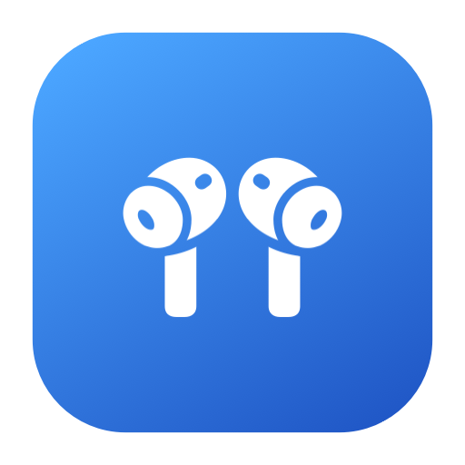
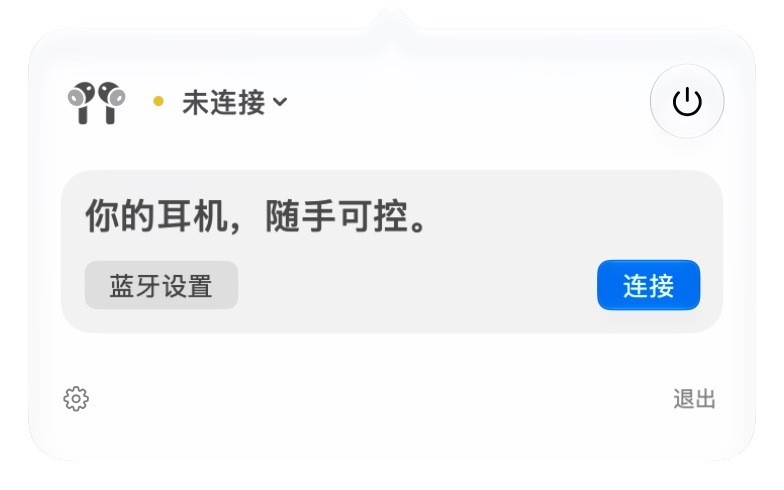
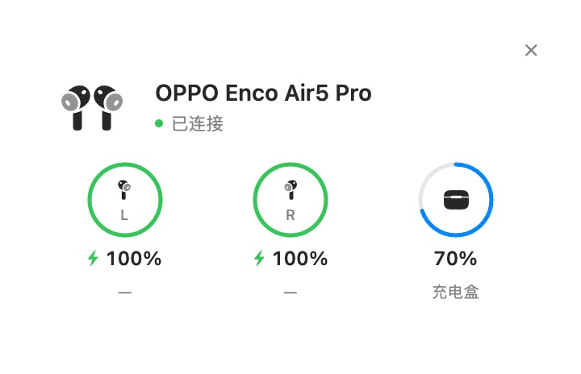
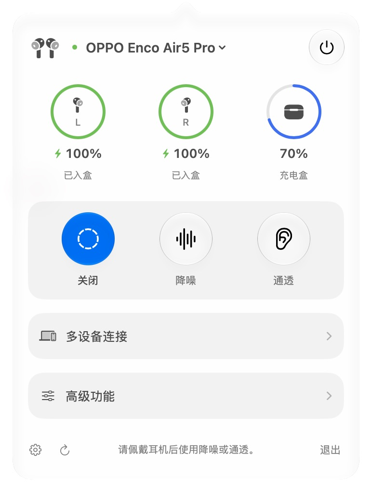
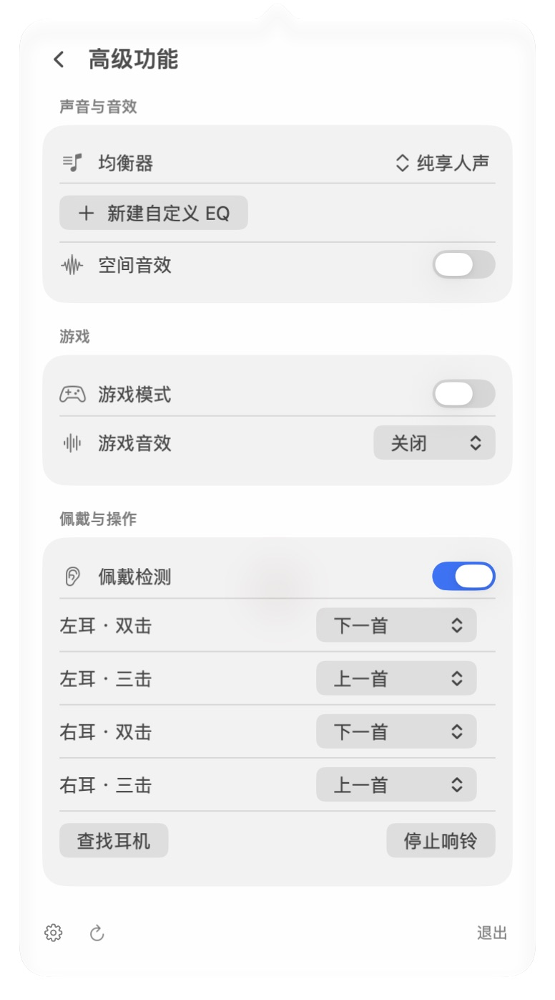

# HeyBuds

**你的耳机，随手可控。**

轻量、原生的 macOS 菜单栏耳机助手

[下载应用](https://github.com/abaichuan1017/HeyBuds/releases/latest) · [English](README_EN.md) · [完整型号清单](docs/SUPPORTED_DEVICES.md)

在菜单栏查看电量、切换降噪与通透、调整音效和管理多设备连接。支持中文和英文，采用原生界面，并通过 Sparkle 提供应用内更新。无遥测。

<table>
  <tr><th>未连接</th><th>连接弹窗</th></tr>
  <tr>
    <td valign="top"></td>
    <td valign="top"></td>
  </tr>
  <tr><th>主面板</th><th>高级功能</th></tr>
  <tr>
    <td valign="top"></td>
    <td valign="top"></td>
  </tr>
</table>

## 支持范围

| 设备 | 功能 |
| --- | --- |
| 已适配耳机 | 按型号提供电量、降噪、EQ 等功能 |
| 未适配的蓝牙耳机和音箱 | 连接和断开提醒显示系统蓝牙名称。macOS 支持时，可在连接弹窗或主面板调节音量。 |

已适配部分 OPPO / OnePlus / realme、vivo / iQOO、华为 / 荣耀、小米 / Redmi、漫步者、声阔、森海塞尔、JBL、三星、Google、Bose、Nothing / CMF 和 Sony 型号。

[完整型号清单](docs/SUPPORTED_DEVICES.md) · [功能与限制](docs/COMPATIBILITY.md) · [验证记录](docs/VALIDATION.md)

## 安装与使用

HeyBuds 0.6.3 适用于 **运行 macOS 15 或更高版本的 Apple Silicon Mac**。

1. 下载并打开 `HeyBuds-arm64.dmg`，将 HeyBuds 拖入「应用程序」。[下载最新版](https://github.com/abaichuan1017/HeyBuds/releases/latest)
2. 在系统蓝牙设置中配对并连接耳机。打开 HeyBuds，允许蓝牙访问后从菜单栏选择设备。

首次打开 HeyBuds 时，可能需要在「系统设置 → 隐私与安全性」中点击「仍要打开」。[Apple 说明](https://support.apple.com/zh-cn/102445)

找不到耳机时，在设备菜单选择「重新查找设备」。

## 开发与反馈

构建需要 Swift 6.4 和 macOS 27 SDK。[构建与贡献](CONTRIBUTING.md) · [更新记录](CHANGELOG.md) · [反馈问题](https://github.com/abaichuan1017/HeyBuds/issues)

## 许可与致谢

采用 [GPL-3.0-or-later](LICENSE) 许可。[致谢](THIRD_PARTY_NOTICES.md)

HeyBuds 是独立社区项目，与所列品牌无隶属关系。
