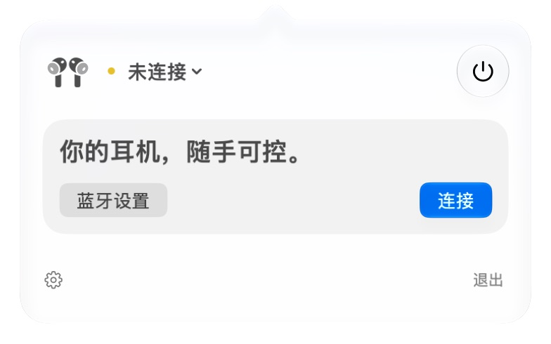
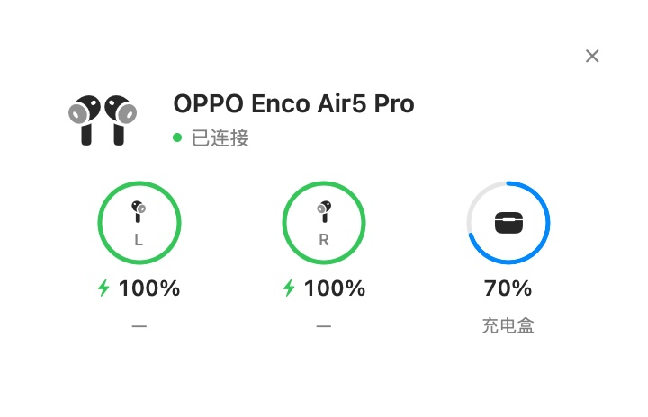
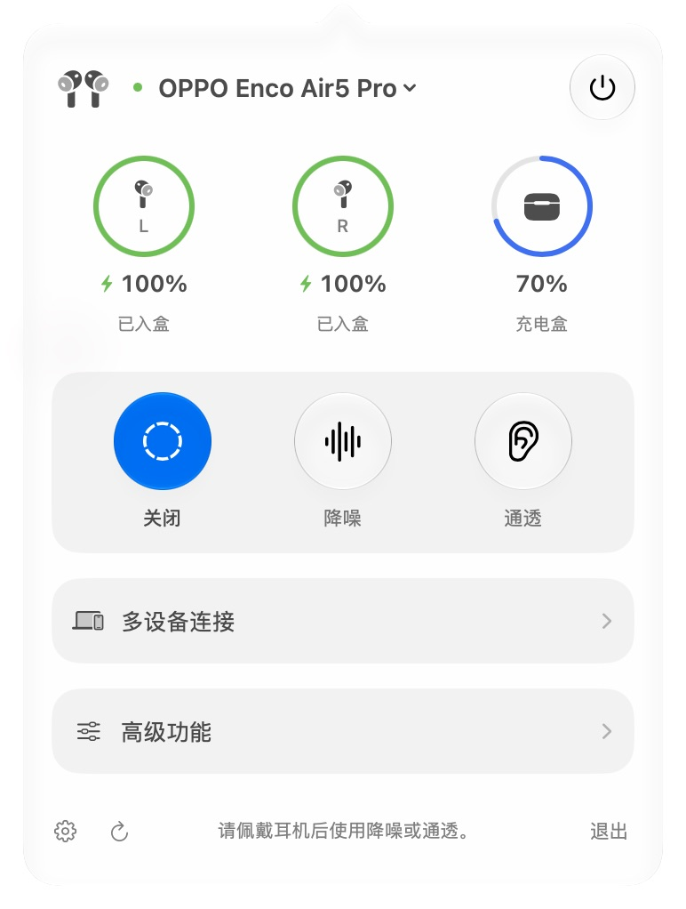
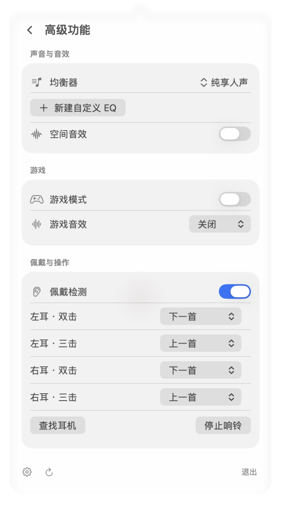

<div align="center">


# HeyBuds

**你的耳机，随手可控。**

轻量、原生的 macOS 菜单栏耳机助手

[下载应用](https://github.com/abaichuan1017/HeyBuds/releases/latest) · [English](README_EN.md) · [完整型号清单](docs/SUPPORTED_DEVICES.md)

</div>

在菜单栏查看电量、切换降噪与通透、调整音效和管理多设备连接。支持中文和英文，采用原生界面，并通过 Sparkle 提供应用内更新。无遥测。

<table>
  <tr><th>未连接</th><th>连接弹窗</th></tr>
  <tr>
    <td valign="top"></td>
    <td valign="top"></td>
  </tr>
  <tr><th>主面板</th><th>高级功能</th></tr>
  <tr>
    <td valign="top"></td>
    <td valign="top"></td>
  </tr>
</table>

## 支持范围

| 品牌 | 已接入能力 |
| --- | --- |
| OPPO / OnePlus / realme | 电量、降噪、EQ、空间与游戏音效、多设备 |
| vivo / iQOO | 电量、降噪、EQ、空间与游戏音效、多设备 |
| HUAWEI / HONOR | 华为原有功能；荣耀 Earbuds 2 / 2 SE / 2 Lite 按 FreeBuds 4i 配置接入 |
| Xiaomi / Redmi | 16 款明确型号：10 款按型号接入降噪、EQ、手势等控制，6 款仅基础信息/电量；详见[功能范围](docs/XIAOMI_SUPPORT.md) |
| EDIFIER | 支持 SPP 的系列电量及降噪 |
| Soundcore / 声阔 | Q30 / Q35 / Q45 / Space One Pro / Liberty 4 NC / 4 Pro / 5：电量、降噪、预设与自定义 EQ；部分型号双连开关 |
| Sennheiser / 森海塞尔 | MOMENTUM 4 / 5：电量、降噪、EQ、佩戴检测与设备列表；M5 写入限 6.21.5 固件 |
| JBL | TUNE230NC TWS / Wave Buds 2 / Tune 770NC：降噪与环境声；Wave Buds 2 另有电量 |
| Samsung | 13 款 Galaxy Buds：电量、各型号具备的降噪/环境声和预设 EQ；Buds2/2 Pro 触控锁、Buds4 Pro 降噪强度 |
| Google | Pixel Buds Pro / Pro 2：电量、降噪与五组 EQ 预设 |
| Bose | QC35 / QC35 II：电量、ANC 开关，无通透；QC45 / Ultra 二代头戴及耳塞保留模式与降噪级别控制 |
| Nothing / CMF | 11 款型号的电量与预设 EQ，具备降噪的型号开放基础模式；Ear (stick) 无降噪 |
| Sony | 12 款型号的电量与降噪/通透；WF-C700N 降噪写入限 2.0.7 固件，ULT WEAR 无通透强度控件 |

新增 39 款的[功能与限制](docs/DESKTOP_EXPANSION.md)已逐组列出，另增加 [16 款 Xiaomi / Redmi 配置](docs/XIAOMI_SUPPORT.md)，源码目录共 283 条。新增型号均为初步协议接入，HeyBuds/macOS 实机兼容性待验证。

具体功能取决于型号、固件和设备响应。详见[型号清单](https://github.com/abaichuan1017/HeyBuds/blob/main/docs/SUPPORTED_DEVICES.md)与[兼容性说明](https://github.com/abaichuan1017/HeyBuds/blob/main/docs/COMPATIBILITY.md)。

## 安装与使用

正式版 0.6.0 需要 **Apple Silicon Mac、macOS 26+**。[0.6.1-beta.2 测试版](https://github.com/abaichuan1017/HeyBuds/releases/tag/v0.6.1-beta.2)新增 **macOS 15+** 支持：macOS 26+ 保留原有玻璃界面，macOS 15 使用兼容材质和按钮。macOS 15 真机体验仍待验证与反馈。

1. 从 [Releases](https://github.com/abaichuan1017/HeyBuds/releases/latest) 下载 `HeyBuds-arm64.dmg`，打开后将 HeyBuds 拖入“应用程序”。
2. 在系统蓝牙设置中配对并连接耳机，退出其他耳机控制器。
3. 打开 HeyBuds 并允许蓝牙访问，点击菜单栏图标选择耳机。
4. 在主面板调节降噪，在“高级功能”调整音效；设置中可开启连接提示、低电量提醒、自动重连和登录时启动。

macOS 15 用户请从上述测试版页面下载 DMG。测试版需手动选择下载，应用内更新继续使用正式版通道。

设置底部可查看版本、下载并安装更新。“请作者喝杯咖啡”可选择金额并显示对应收款码，请使用支付宝扫码。底栏依次提供项目名称与许可、GitHub、脱敏诊断和退出。

应用尚未公证。若 macOS 阻止打开，确认下载来源后，在“系统设置 → 隐私与安全性”选择“仍要打开”，参见 [Apple 说明](https://support.apple.com/zh-cn/102445)。

找不到耳机时，先确认系统蓝牙已连接，再从设备菜单选择“重新查找设备”。状态缺失时可点底部刷新；从 EncoBar 升级请先退出旧应用，偏好会自动迁移。

## 从源码构建

需要 Swift 6.4 和 macOS 27 SDK。

```sh
git clone https://github.com/abaichuan1017/HeyBuds.git
cd HeyBuds
swift test --no-parallel
bash scripts/build.sh
open dist/HeyBuds.app
```

输出为 `dist/HeyBuds.app` 和 `dist/HeyBuds-arm64.dmg`。发行构建只打包应用、运行资源与许可；开发工具、参考表和文档保留在源码中。

[贡献指南](CONTRIBUTING.md) · [架构](docs/ARCHITECTURE.md) · [验证记录](docs/VALIDATION.md) · [更新记录](CHANGELOG.md) · [反馈问题](https://github.com/abaichuan1017/HeyBuds/issues)

## 许可与致谢

采用 [GPL-3.0-or-later](LICENSE) 许可。协议与型号资料主要来自 [OppoPodsManager](https://github.com/Zhaoyi-ya/OppoPodsManager)，并参考 [Realme TWS Mac Controller](https://github.com/anikket-b/Realme-TWS-Mac-Controller)。完整署名见[第三方声明](THIRD_PARTY_NOTICES.md)。

HeyBuds 是独立社区项目，与所列品牌无隶属关系。
