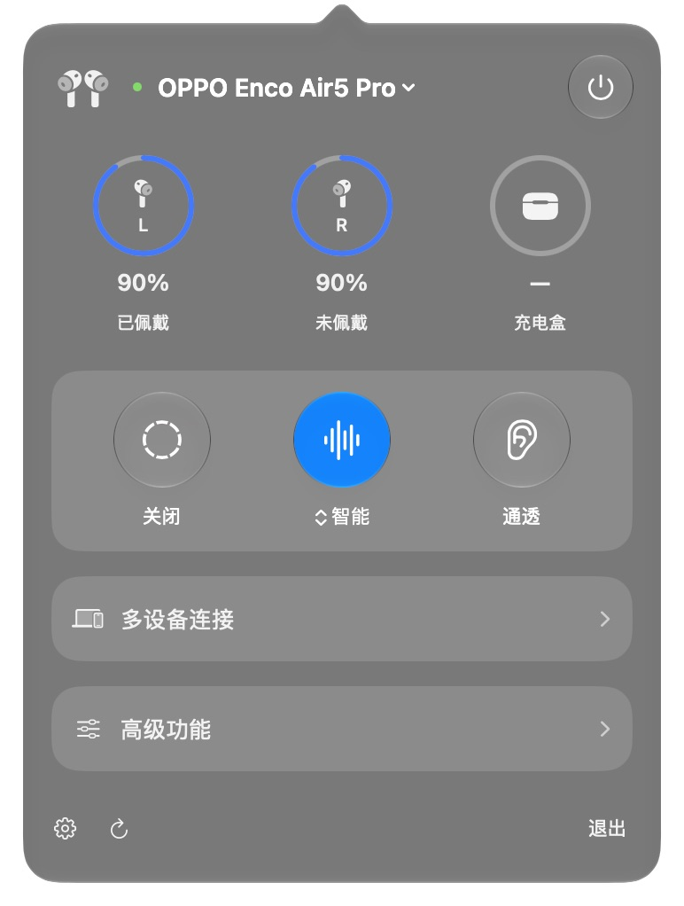
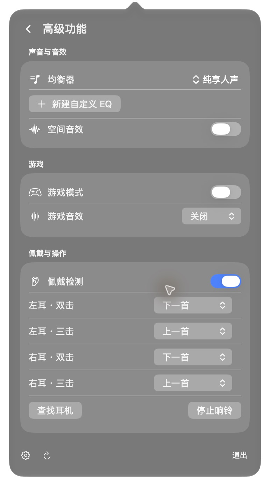

<div align="center">


# HeyBuds

**你的耳机，随手可控。**

原生 macOS 菜单栏耳机管理工具

[下载应用](https://github.com/abaichuan1017/HeyBuds/releases/latest) · [English](README_EN.md) · [支持的耳机](#支持的耳机) · [安装与使用](#安装与使用)

</div>

在菜单栏查看耳机电量，切换降噪与通透，调整音效，管理多设备连接。支持中文和英文。

## 应用截图

<table>
  <tr><th>主面板</th><th>高级功能</th></tr>
  <tr>
    <td valign="top"></td>
    <td valign="top"></td>
  </tr>
</table>

## 功能

- 查看左右耳与充电盒电量、充电和佩戴状态。
- 切换降噪、通透和降噪强度。
- 调整均衡器、自定义 EQ、空间音效和游戏模式。
- 查看多设备连接，连接或断开支持的设备。
- 连接提示、低电量提醒、自动重连、后台运行和登录时启动。

## 支持的耳机

| 品牌 | 常见型号 |
| --- | --- |
| OPPO | Enco Air5 Pro、Air5、Air4 Pro、Air4、Air3 Pro、X3、X3i、X3s、X2、Free4、Clip、Clip2 |
| OnePlus | Buds Pro 3、Pro 2、Pro、Buds 4、Buds 3、Nord Buds 4、Nord Buds 3 Pro、Buds Ace 3、Open Buds |
| realme | Buds Air8 Pro、Air8、Air7 Pro、Air7、Air6 Pro、Air6、T500 Pro、T500、T310、T300、Buds Clip |
| vivo | TWS 5 Pro、TWS 5 Hi-Fi、TWS 5、TWS 4 Hi-Fi、TWS 4、TWS 3 Pro、TWS 3、TWS Air3 Pro、TWS Neo |
| iQOO | TWS 5、TWS 5e、TWS 5i、TWS 2、TWS 1、TWS Air3 Pro、TWS Air3、TWS Air2 |
| HUAWEI | FreeBuds Pro 5、Pro 4、Pro 3、Pro 2、FreeBuds 6i、5i、7i、FreeClip 2、FreeClip、FreeLace Pro 2 |
| Xiaomi / Redmi | Xiaomi、Redmi 耳机系列识别 |
| EDIFIER | W820NB、W200BT 及使用 SPP 协议的 EDIFIER 系列 |
| Apple / Beats | AirPods 1 至 4、AirPods Pro 1 至 3、AirPods Max、Beats Fit Pro、Powerbeats Pro、Beats Flex、Beats Solo 3 |

[查看完整型号清单](docs/SUPPORTED_DEVICES.md)

列表来自已接入的型号目录，尚未逐款实机验证。具体功能因型号和固件而异，AirPods 与 Beats 仅支持读取状态。详见[兼容性说明](docs/COMPATIBILITY.md)。

## 安装与使用

需要 **Apple Silicon Mac 和 macOS 27 或更新版本**。

### 安装

1. 在 [Releases](https://github.com/abaichuan1017/HeyBuds/releases/latest) 下载 `HeyBuds-arm64.zip`。
2. 解压，将 `HeyBuds.app` 拖入“应用程序”文件夹。
3. 打开 HeyBuds，按提示允许蓝牙访问。

当前应用尚未公证。若系统阻止打开，确认安装包来自本仓库后，可按 [Apple 官方说明](https://support.apple.com/zh-cn/102445)，在“系统设置 → 隐私与安全性”中选择“仍要打开”。

### 使用

1. 在 macOS 蓝牙设置中配对并连接耳机，退出其他耳机控制工具。
2. 点击菜单栏的 HeyBuds 图标，在顶部选择耳机。若控制尚未连接，点击右上角电源按钮。
3. 在主面板查看电量、切换降噪；进入“高级功能”调整音效，进入“多设备连接”管理连接设备。
4. 在设置中开启自动重连、低电量提醒或登录时启动。使用提醒时允许通知访问。

### 常见问题

- **找不到耳机**：确认耳机已在系统蓝牙设置中连接，再从顶部设备菜单选择“重新查找设备”。
- **没有电量或控制选项**：保持耳机在连接范围内，点击底部刷新按钮。部分功能仅在对应型号上提供。
- **从 EncoBar 升级**：先退出旧应用，再启动 HeyBuds，已有偏好会自动迁移。

## 从源码构建

需要 Swift 6.4 和 macOS 27 SDK。

```sh
git clone https://github.com/abaichuan1017/HeyBuds.git
cd HeyBuds
swift test
bash scripts/build.sh
open dist/HeyBuds.app
```

[贡献指南](CONTRIBUTING.md) · [项目架构](docs/ARCHITECTURE.md) · [更新记录](CHANGELOG.md) · [反馈问题](https://github.com/abaichuan1017/HeyBuds/issues)

## 许可与致谢

采用 [GPL-3.0-or-later](LICENSE) 许可。协议与型号资料主要来自 [OppoPodsManager](https://github.com/Zhaoyi-ya/OppoPodsManager)，并参考 [Realme TWS Mac Controller](https://github.com/anikket-b/Realme-TWS-Mac-Controller)。完整署名见[第三方声明](THIRD_PARTY_NOTICES.md)。

HeyBuds 是独立社区项目，与所列品牌无隶属关系。
