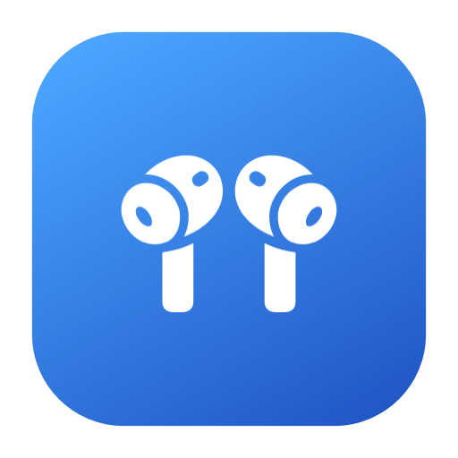
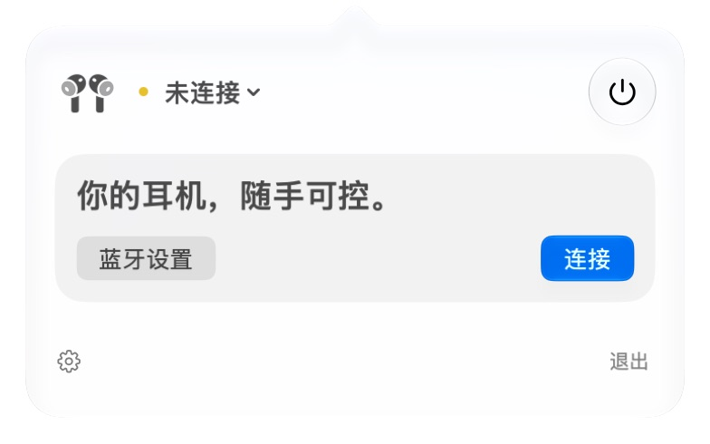
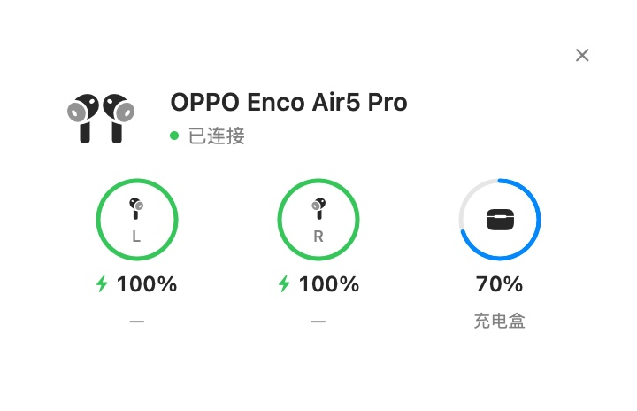
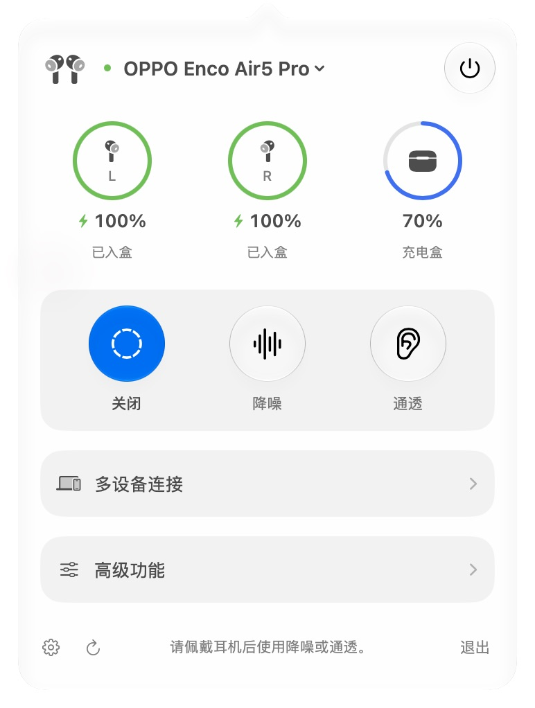
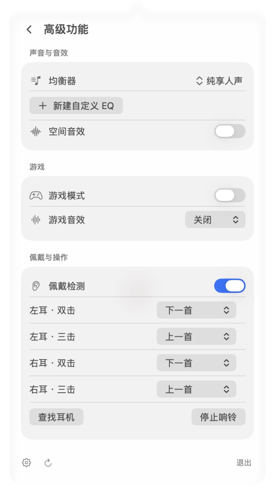

<div align="center">



# HeyBuds

**Your earbuds, a click away.**

A lightweight, native macOS menu bar companion

[Download](https://github.com/abaichuan1017/HeyBuds/releases/latest) · [简体中文](README.md) · [Full model list](docs/SUPPORTED_DEVICES.md)

</div>

Check battery levels, switch noise modes, adjust sound and manage connected devices. Available in Chinese and English. Uses a native interface and Sparkle for in-app updates. No telemetry.

<table>
  <tr><th>Disconnected</th><th>Connection pop-up</th></tr>
  <tr>
    <td valign="top"></td>
    <td valign="top"></td>
  </tr>
  <tr><th>Main panel</th><th>Advanced features</th></tr>
  <tr>
    <td valign="top"></td>
    <td valign="top"></td>
  </tr>
</table>

## Compatibility

| Brand | Integrated capabilities |
| --- | --- |
| OPPO / OnePlus / realme | Battery, noise control, EQ, spatial and gaming audio, connected devices |
| vivo / iQOO | Battery, noise control, EQ, spatial and gaming audio, connected devices |
| HUAWEI / HONOR | Existing Huawei features; HONOR Earbuds 2 / 2 SE / 2 Lite use the FreeBuds 4i profile |
| Xiaomi / Redmi | 16 explicit models: 10 with model-specific noise/EQ/gesture controls and 6 for read-only information/battery; see [scope](docs/XIAOMI_SUPPORT.md) |
| EDIFIER | Battery and noise control for supported SPP families |
| Soundcore | Q30 / Q35 / Q45 / Space One Pro / Liberty 4 NC / 4 Pro / 5: battery, noise control, preset/custom EQ; dual-connect switch on selected models |
| Sennheiser | MOMENTUM 4 / 5: battery, noise control, EQ, wear detection and peer list; M5 writes limited to firmware 6.21.5 |
| JBL | TUNE230NC TWS / Wave Buds 2 / Tune 770NC: noise control; battery on Wave Buds 2 |
| Samsung | 13 Galaxy Buds models: battery, model-specific noise modes and preset EQ; touch lock on Buds2/2 Pro and ANC strength on Buds4 Pro |
| Google | Pixel Buds Pro / Pro 2: battery, noise control and five EQ presets |
| Bose | QC35 / QC35 II: battery and ANC on/off, no transparency; QC45 and second-generation Ultra profiles retain mode and cancellation-level controls |
| Nothing / CMF | 11 models with battery and preset EQ; basic noise modes where supported, no noise control on Ear (stick) |
| Sony | 12 models with battery and noise control; WF-C700N noise writes limited to firmware 2.0.7, no ambient-level control on ULT WEAR |

The [39-model expansion](docs/DESKTOP_EXPANSION.md) is joined by [16 explicit Xiaomi / Redmi profiles](docs/XIAOMI_SUPPORT.md), bringing the catalog to 283 entries. New models have initial protocol support; HeyBuds/macOS hardware compatibility remains unverified.

Features depend on the model, firmware and device responses. See the [model list](https://github.com/abaichuan1017/HeyBuds/blob/main/docs/SUPPORTED_DEVICES.md) and [compatibility notes](https://github.com/abaichuan1017/HeyBuds/blob/main/docs/COMPATIBILITY.md).

## Install and use

Stable 0.6.0 requires an **Apple Silicon Mac running macOS 26+**. The [0.6.1-beta.1 prerelease](https://github.com/abaichuan1017/HeyBuds/releases/tag/v0.6.1-beta.1) adds **macOS 15+** support: macOS 26+ retains the existing Liquid Glass interface, while macOS 15 uses compatible materials and buttons. Verification and feedback on physical Macs running macOS 15 are still pending.

1. Download `HeyBuds-arm64.dmg` from [Releases](https://github.com/abaichuan1017/HeyBuds/releases/latest), open it and drag HeyBuds to Applications.
2. Pair and connect your earbuds in Bluetooth settings, then quit other earbud controllers.
3. Open HeyBuds, allow Bluetooth access and select your earbuds from its menu bar icon.
4. Use the main panel for noise control and Advanced features for sound settings. Settings includes connection pop-ups, low-battery alerts, automatic reconnection and launch at login.

On macOS 15, download the DMG from the prerelease page above. Prereleases are manual downloads; in-app updates continue to use the stable channel.

The bottom of Settings shows the version and in-app update action. The separate coffee support entry displays a payment QR code for the selected amount; scan it with Alipay. The footer contains the app name and license, GitHub, redacted diagnostics and Quit.

The app is not notarized. If macOS blocks it, verify the download source and choose Open Anyway in System Settings → Privacy & Security. See [Apple's instructions](https://support.apple.com/en-us/102445).

If your earbuds are missing, check their system Bluetooth connection, then choose Refresh devices. Use the bottom refresh button for missing readings. When upgrading from EncoBar, quit the old app first; preferences migrate automatically.

## Build from source

Requires Swift 6.4 and the macOS 27 SDK.

```sh
git clone https://github.com/abaichuan1017/HeyBuds.git
cd HeyBuds
swift test --no-parallel
bash scripts/build.sh
open dist/HeyBuds.app
```

Outputs: `dist/HeyBuds.app` and `dist/HeyBuds-arm64.dmg`. Release builds contain the application, runtime resources and license notices. Developer tools, reference tables and documentation remain in the source tree.

[Contributing](CONTRIBUTING.md) · [Architecture](docs/ARCHITECTURE.md) · [Validation](docs/VALIDATION.md) · [Changelog](CHANGELOG.md) · [Report an issue](https://github.com/abaichuan1017/HeyBuds/issues)

## License and credits

Licensed under [GPL-3.0-or-later](LICENSE). Protocols and model data are primarily based on [OppoPodsManager](https://github.com/Zhaoyi-ya/OppoPodsManager), with references from [Realme TWS Mac Controller](https://github.com/anikket-b/Realme-TWS-Mac-Controller). See [third-party notices](THIRD_PARTY_NOTICES.md) for full attribution.

HeyBuds is an independent community project, unaffiliated with the listed brands.
