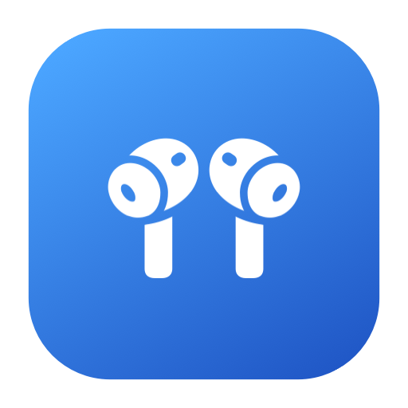
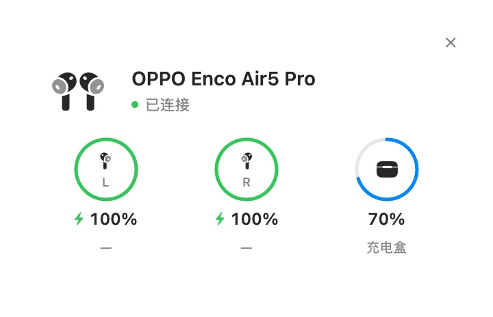
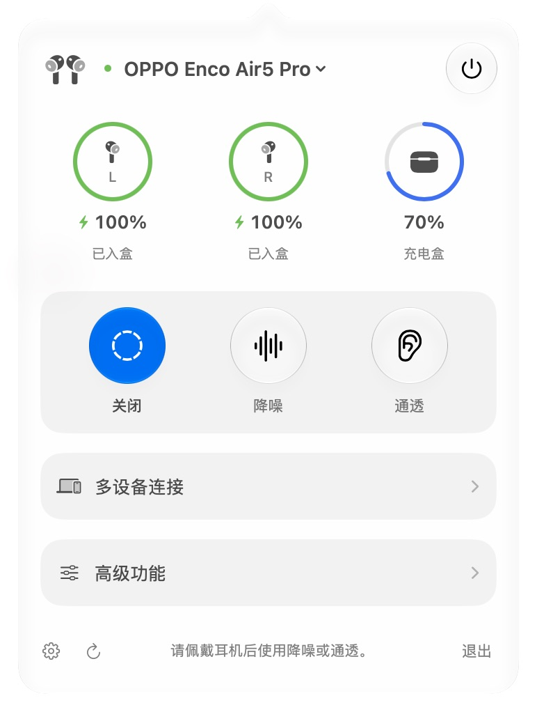
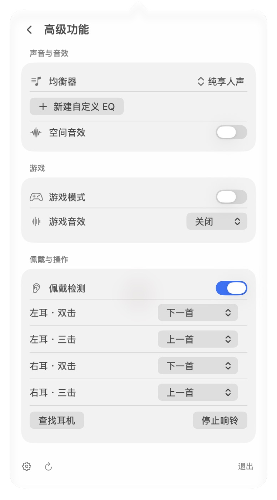

# HeyBuds

**Your earbuds, a click away.**

A lightweight, native macOS menu bar companion

[Download](https://github.com/abaichuan1017/HeyBuds/releases/latest) · [简体中文](README.md) · [Full model list](docs/SUPPORTED_DEVICES.md)

Check battery levels, switch noise modes, adjust sound and manage connected devices. Available in Chinese and English. Uses a native interface and Sparkle for in-app updates. No telemetry.

<table>
  <tr><th>Disconnected</th><th>Connection pop-up</th></tr>
  <tr>
    <td valign="top"></td>
    <td valign="top"></td>
  </tr>
  <tr><th>Main panel</th><th>Advanced features</th></tr>
  <tr>
    <td valign="top"></td>
    <td valign="top"></td>
  </tr>
</table>

## Compatibility

| Device | Features |
| --- | --- |
| Supported headphones | Battery, noise control, EQ and other features depending on the model |
| Other Bluetooth headphones and speakers | Connection and disconnection pop-ups show the system Bluetooth name. Where macOS allows it, adjust volume in the connection pop-up or main panel. |

Supported models include select devices from OPPO / OnePlus / realme, vivo / iQOO, HUAWEI / HONOR, Xiaomi / Redmi, EDIFIER, Soundcore, Sennheiser, JBL, Samsung, Google, Bose, Nothing / CMF and Sony.

[Full model list](docs/SUPPORTED_DEVICES.md) · [Features and limitations](docs/COMPATIBILITY.md) · [Validation](docs/VALIDATION.md)

## Install and use

HeyBuds 0.6.3 supports **Apple Silicon Macs running macOS 15 or later**.

1. Download and open `HeyBuds-arm64.dmg` and drag HeyBuds to Applications. [Download the latest version](https://github.com/abaichuan1017/HeyBuds/releases/latest)
2. Pair and connect your earbuds in Bluetooth settings. Open HeyBuds, allow Bluetooth access and select the device from the menu bar.

On first launch, you may need to choose **Open Anyway** in **System Settings → Privacy & Security**. [Apple’s instructions](https://support.apple.com/en-us/102445)

If your earbuds are missing, choose Refresh devices from the device menu.

## Development and feedback

Building requires Swift 6.4 and the macOS 27 SDK. [Build and contribute](CONTRIBUTING.md) · [Changelog](CHANGELOG.md) · [Report an issue](https://github.com/abaichuan1017/HeyBuds/issues)

## License and credits

Licensed under [GPL-3.0-or-later](LICENSE). [Acknowledgements](THIRD_PARTY_NOTICES.md)

HeyBuds is an independent community project, unaffiliated with the listed brands.
