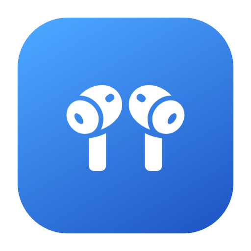
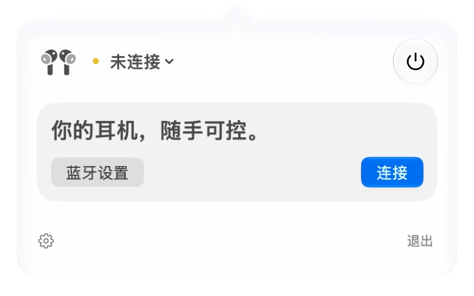
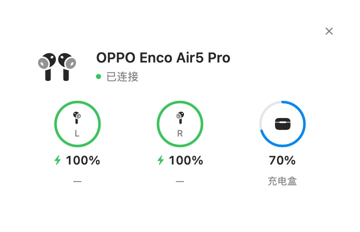
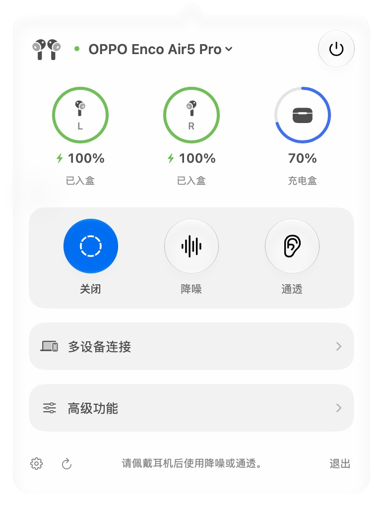
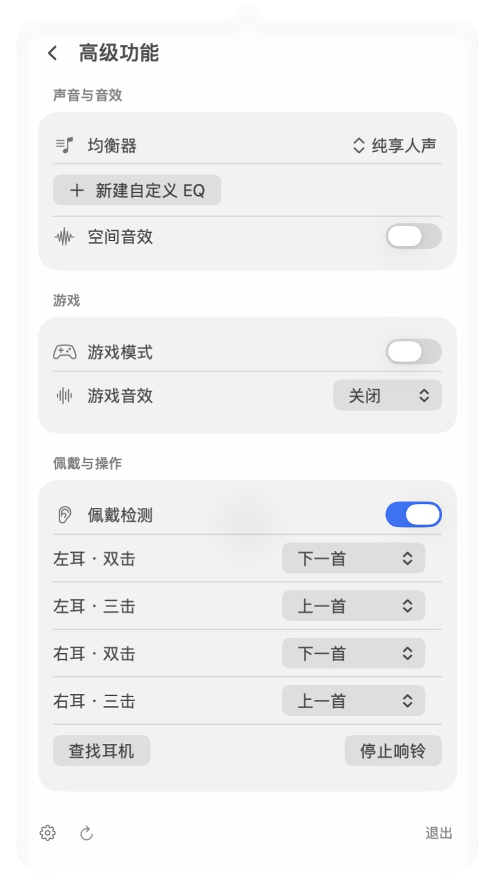

<div align="center">



# HeyBuds

**Your earbuds, a click away.**

A lightweight, native macOS menu bar companion

[Download](https://github.com/abaichuan1017/HeyBuds/releases/latest) · [简体中文](README.md) · [Full model list](docs/SUPPORTED_DEVICES.md)

</div>

Check battery levels, switch noise modes, adjust sound and manage connected devices. Available in Chinese and English. Uses a native interface and Sparkle for in-app updates. No telemetry.

<table>
  <tr><th>Disconnected</th><th>Connection pop-up</th></tr>
  <tr>
    <td valign="top"></td>
    <td valign="top"></td>
  </tr>
  <tr><th>Main panel</th><th>Advanced features</th></tr>
  <tr>
    <td valign="top"></td>
    <td valign="top"></td>
  </tr>
</table>

## Compatibility

| Brand | Integrated capabilities |
| --- | --- |
| OPPO / OnePlus / realme | Battery, noise control, EQ, spatial and gaming audio, connected devices |
| vivo / iQOO | Battery, noise control, EQ, spatial and gaming audio, connected devices |
| HUAWEI | Battery, noise control, EQ, custom EQ, connected devices |
| Xiaomi / Redmi | Family detection and battery; low latency requires valid state readback |
| EDIFIER | Battery and noise control for supported SPP families |

Features depend on the model, firmware and device responses. See the [model list](https://github.com/abaichuan1017/HeyBuds/blob/main/docs/SUPPORTED_DEVICES.md) and [compatibility notes](https://github.com/abaichuan1017/HeyBuds/blob/main/docs/COMPATIBILITY.md).

## Install and use

Requires an **Apple Silicon Mac running macOS 26+**.

1. Download `HeyBuds-arm64.dmg` from [Releases](https://github.com/abaichuan1017/HeyBuds/releases/latest), open it and drag HeyBuds to Applications.
2. Pair and connect your earbuds in Bluetooth settings, then quit other earbud controllers.
3. Open HeyBuds, allow Bluetooth access and select your earbuds from its menu bar icon.
4. Use the main panel for noise control and Advanced features for sound settings. Settings includes connection pop-ups, low-battery alerts, automatic reconnection and launch at login.

The bottom of Settings shows the version and in-app update action, followed by a separate coffee support entry. The GitHub icon opens the project, and the bottom-right diagnostic button exports a redacted report.

The app is not notarized. If macOS blocks it, verify the download source and choose Open Anyway in System Settings → Privacy & Security. See [Apple's instructions](https://support.apple.com/en-us/102445).

If your earbuds are missing, check their system Bluetooth connection, then choose Refresh devices. Use the bottom refresh button for missing readings. When upgrading from EncoBar, quit the old app first; preferences migrate automatically.

## Build from source

Requires Swift 6.4 and the macOS 27 SDK.

```sh
git clone https://github.com/abaichuan1017/HeyBuds.git
cd HeyBuds
swift test
bash scripts/build.sh
open dist/HeyBuds.app
```

Outputs: `dist/HeyBuds.app` and `dist/HeyBuds-arm64.dmg`. Release builds contain the application, runtime resources and license notices. Developer tools, reference tables and documentation remain in the source tree.

[Contributing](CONTRIBUTING.md) · [Architecture](docs/ARCHITECTURE.md) · [Validation](docs/VALIDATION.md) · [Changelog](CHANGELOG.md) · [Report an issue](https://github.com/abaichuan1017/HeyBuds/issues)

## License and credits

Licensed under [GPL-3.0-or-later](LICENSE). Protocols and model data are primarily based on [OppoPodsManager](https://github.com/Zhaoyi-ya/OppoPodsManager), with references from [Realme TWS Mac Controller](https://github.com/anikket-b/Realme-TWS-Mac-Controller). See [third-party notices](THIRD_PARTY_NOTICES.md) for full attribution.

HeyBuds is an independent community project, unaffiliated with the listed brands.
